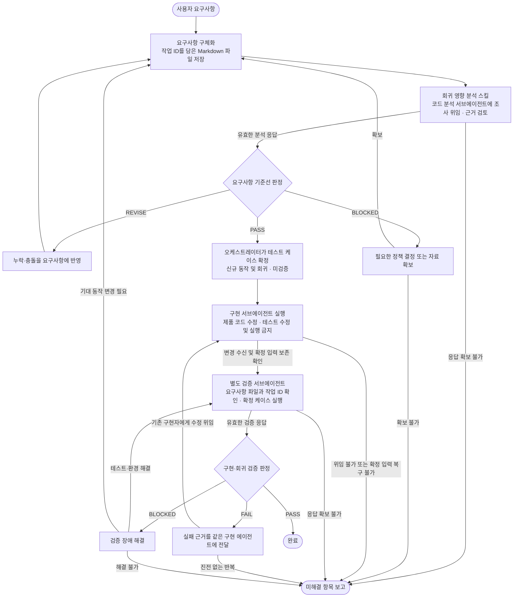

# 피드백 루프 순서도

## 전이 조건

`scripts/transition.mjs move` 가 아래 조건을 확인한다. 조건을 확인하지 못하면 상태를 바꾸지 않는다.

| 이동 | 근거 파일 | 스크립트가 확인하는 것 |
| --- | --- | --- |
| `refine → analyze` | — | `requirements.md` 가 있고, front matter 의 `task_id` 가 작업 ID 와 같고, `AC-xx` 수용 기준이 하나 이상 있다. 이때 요구사항 해시를 기록하고, 이전 분석과 확정 케이스는 무효로 한다. |
| `analyze → requirementsGate` | `analysis-<n>.json` | 응답의 `task_id`·`requirements_hash` 가 현재 요구사항과 같다. `status` 가 유효하고 판정별 조건(PASS: 모든 기준의 coverage, 미결 기준·이슈 없음, 후보마다 확인 방법 / REVISE: `REQUIREMENT_GAP` 이슈 / BLOCKED: 결정·증거 이슈)을 만족한다. 모든 `consumers` 가 회귀 후보에 연결되었거나 영향 없음 근거가 있다. 한 번 쓴 파일은 다시 쓸 수 없다. |
| `analyze → incomplete` | — | `--reason` 이 있다. 분석을 다시 실행해도 유효한 응답을 얻지 못한 경우에 쓴다. |
| `requirementsGate → cases` / `revise` / `clarify` | — | 직전 분석 판정이 각각 PASS / REVISE / BLOCKED 다. |
| `cases → implement` | `cases.md` | 요구사항이 분석 이후 바뀌지 않았다. 모든 `AC-xx` 와 분석의 `REQUIRED` 후보 `REG-xx` 가 케이스 파일에 나온다. `CASE-xx` 가 하나 이상 있다. 케이스 해시를 기록한다. |
| `implement → verify` | `implementation-<n>.md` | 요구사항과 확정 케이스가 그대로다. |
| `verify → verificationGate` | `verification-<n>.json` | 요구사항과 확정 케이스가 그대로다. 응답의 `task_id`·`requirements_file` 이 현재 작업과 같다. PASS 이면 모든 확정 케이스의 결과가 있고 필수 케이스가 모두 PASS 다. FAIL 이면 실패 케이스가, BLOCKED 이면 이슈가 있다. |
| `verificationGate → done` / `feedback` / `resolve` | — | 직전 검증 판정이 각각 PASS / FAIL / BLOCKED 다. |
| `→ incomplete` | — | `--reason` 에 미해결 항목과 사유가 있다. |
